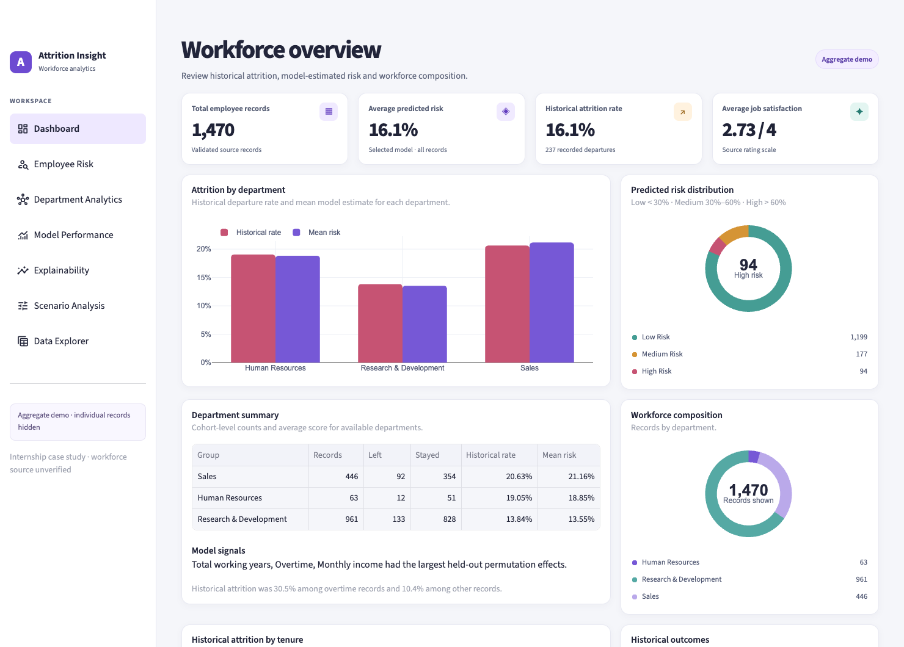

# Attrition Insight

Employee Attrition Prediction and Risk Scoring System for an internship capstone. The Streamlit demo shows historical workforce patterns, held-out model evaluation, and model interpretation using reviewed aggregate outputs.



## Run the demo

Use Python 3.12. The app loads the included aggregate results at startup.

```bash
python3.12 -m venv .venv
source .venv/bin/activate
python -m pip install -r requirements.txt
python -m streamlit run app.py
```

On Windows PowerShell, use `py -3.12 -m venv .venv` and `.\.venv\Scripts\Activate.ps1`.

| Page | What to explore |
|---|---|
| Dashboard | Cohort comparisons, workforce composition, and three score bands |
| Department Analytics | Department and role comparisons, plus overtime and satisfaction |
| Model Performance | Held-out metrics, confusion matrix, ROC, precision–recall, and calibration plots |
| Explainability | Global feature permutation importance |
| Data Explorer | Filterable cohort statistics and aggregate CSV download |
| Employee Risk and Scenario Analysis | Information about the restricted workflows available in the authorized workspace |

The `.aggregate-only` marker keeps this release in aggregate mode. The repository includes training and analysis source code. Reproducing the original experiment requires separately authorized access to the source dataset. The tests run with explicitly synthetic fixtures.

```bash
python -m pytest -q
```

## Model evaluation

The validated case-study snapshot contains 1,470 records and 237 historical departures (16.12%). Logistic Regression led on training cross-validation average precision, narrowly ahead of XGBoost. On 294 held-out records it achieved ROC-AUC **0.787**, average precision **0.569**, precision **55.8%**, recall **51.1%**, and Brier score **0.101**. At its 35.0% classification cutoff it flagged 24 of 47 departures and also flagged 19 stayed records.

[Research report (PDF)](docs/attrition-research-report.pdf) · [Methodology](docs/methodology.md) · [Dataset schema](docs/dataset_schema.md) · [Evaluation JSON](artifacts/metrics/evaluation.json) · [Limitations and ethics](docs/limitations_and_ethics.md)

The input has unverified employer provenance and no observation dates or forecast horizon. Results describe one labeled snapshot. Model associations and scenarios cannot establish intervention effects.

## Streamlit Community Cloud

Select this repository, branch `main`, and entry point `app.py`. In Advanced settings choose Python 3.12. The app uses the root `requirements.txt` and needs no secrets. [Streamlit deployment guide](https://docs.streamlit.io/deploy/streamlit-community-cloud/deploy-your-app/deploy)
